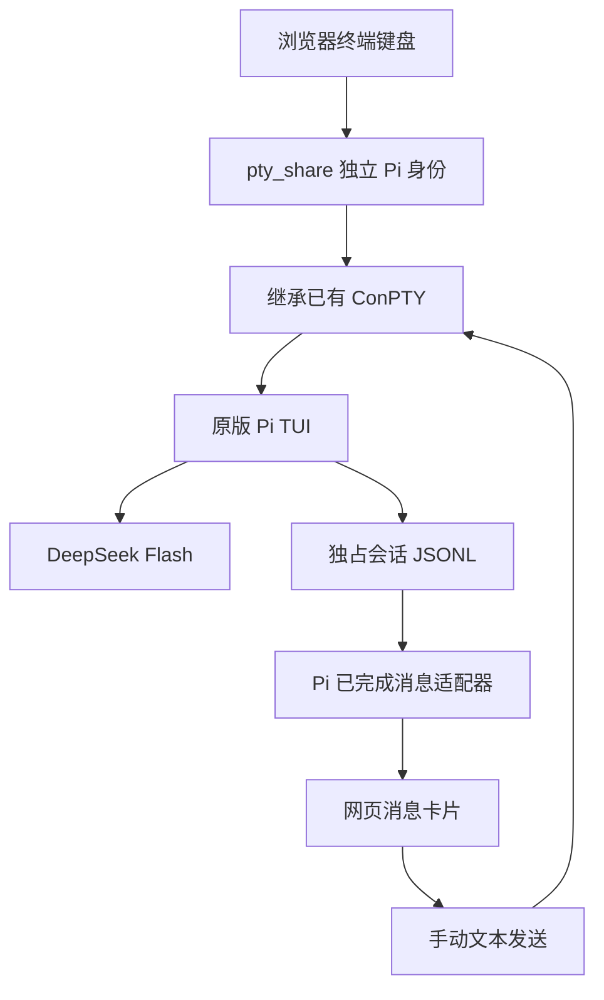

# Pi 接入 pty_share：实现与验收记录

> 基线：`747c217b8`（2026-11-16 checkout）；本机 IFPC，副本 `E:/pi`。
> 本机依赖与官方 gitignored 模型数据已就绪；d2 已加载 Pi → DeepSeek Flash 入口。
> 真实终端输入、最小浏览器键盘链路与独立模型请求已通过；
> 隔离实例完整首页的真实输入、模型回复、消息落盘及 Pi 卡片串联也已通过，见末尾。
> pty_share Pi 菜单与已完成消息渲染代码已落盘；d1 未更新。

## 人话结论

先让网页终端原样承载 Pi 的终端界面，再补可靠的会话身份与忙闲状态。
不能只加一个启动按钮：原先非 Codex 入口会按 Claude 处理；本轮新增 Pi 独立识别与认领保护。
网页消息卡片与原版 Pi TUI 是两条通道；本轮另行实现结构化渲染，本文提供实现契约。

| 交付内容 | 状态 |
|---|---|
| 原版 Pi 的个人 fork 与本机副本 | 建仓任务已完成 |
| Pi 启动、会话、RPC/SDK 接缝 | 本文已按基线说明及源码整理 |
| Alt+M 菜单 | Pi 独立分组置顶、默认展开，保留旧入口与独立紫色角标 |
| Pi 网页渲染 | 已实现已完成消息及工具/错误卡；新增受保护的手动文本发送 |
| 依赖安装 | `npm ci --ignore-scripts` 已完成：335 包、0 vulnerabilities（安装任务输出） |
| 内置模型数据 | 官方 data-only 生成完成：43 个 provider JSON + 1 个 manifest，均 gitignored |
| 无模型请求的启动验证 | 隔离配置下 `pi-test.ps1 --no-env --help` 已输出帮助，exit 0 |
| 会话隔离 | 独立 UUID 与文件；读取时核对 header ID，不借 Claude/Codex 身份 |
| 模型连接与部署 | d2 已使用 Pi → DeepSeek Flash 启动器；真实回复单独验收，d1 未更新 |
| Pi 核心 / 运行服务 | Pi 核心未改；d2 已重启加载接入代码，d1 未更新 |

## 两条通道不能混为一谈

TUI 是终端绘制界面；RPC 是另一进程通过数据命令控制 Pi 的入口，不携带原版 TUI。



| Pi 入口 | 当前能力 | 对本次需求的意义 |
|---|---|---|
| Interactive | 双端为终端时启动 TUI | 保留原生界面的首选入口 |
| Print | 一次运行，输出最终文本 | 不适合作为常驻 TUI |
| `--mode json` | 一次运行，输出结构化事件后退出 | 可用于批处理，不接受后续交互命令 |
| `--mode rpc` | 常驻子进程，双向 JSONL 命令及事件 | 适合自定义客户端，但不是 TUI 的旁路开关 |
| TypeScript SDK | Node.js/Bun 进程内直接使用会话对象 | 当前 Python 宿主无需为此迁移语言 |

依据：`packages/coding-agent/docs/cli-integration.md`；
`packages/coding-agent/src/main.ts` 的 `resolveAppMode()`。
若 stdin 或 stdout 被重定向，未显式选择 JSON/RPC 时会退到 Print，不能用普通管道冒充终端。

## 本机源码启动前提与命令

前提是 Node.js 22.19+；Pi 自身仍沿用 TypeScript，不改写语言。
安装依赖应在仓库根目录；启动时保留目标工程的 cwd（当前工作目录）。

```pwsh
# 已完成：依赖安装不执行 lifecycle scripts
Set-Location E:/pi
npm ci --ignore-scripts
# 已完成：只生成 gitignored 模型 JSON，不改已提交的 wrapper 或 catalog
npm --ignore-scripts run hydrate:model-data

# 当前 preset 使用独立配置，不复用其他客户端账号
$env:PI_CODING_AGENT_DIR = Join-Path $env:APPDATA 'ToolBox/pi'
Set-Location E:/work_noingest
# 无模型请求的源码帮助验证；--no-env 会仅在子进程清除凭据环境变量
pwsh -NoProfile -File E:/pi/pi-test.ps1 --no-env --help
# 当前菜单使用的 DeepSeek 交互启动器（凭据只注入子进程环境）
python E:/ToolBox/pty_share/pi_deepseek.py
```

依据：根 `README.md` 的 Development、根 `AGENTS.md` 的安装安全规则、
`pi-test.ps1` 的 source-resolver 与 `src/cli.ts` 启动方式。
这里的 `pi-test.ps1` 是源码启动器，不是测试命令；不需先跑全仓 build。
缺少 `providers/data/amazon-bedrock.json` 会在 import 阶段报错；上述 hydrate 步骤补齐该前提。
依据：根 `package.json` → `packages/ai/package.json` 的 `hydrate-model-data`，
实际调用 `node catalog/generate.ts --strict --data-only`；已审阅生成器和来源加载器，
只访问公开模型目录，不读取凭据，不执行 npm lifecycle scripts。
仓库 RPC 客户端示例使用 `dist/cli.js`，该示例则需要 built output，不与源码启动混用。

当前 `PI_CODING_AGENT_DIR` 指向 `%APPDATA%\\ToolBox\\pi`，隔离配置、凭据及默认会话位置；
`src/config.ts` 的 `getAgentDir()` 读取它。后续按用户要求通过现有保险箱 accessor
复用 DeepSeek key，仅放子进程环境，不迁移或复制凭据文件；
不接 ToolBox 的 `rlite`、`clite`、`runai_gate`。

## pty_share 最小改动面

下表来自 pty_share 独立调研；路径均位于 `E:/ToolBox/pty_share/`。
此表记录实现前接缝，不代表仍未改动；行号会漂移，以函数名为准。

| 接缝 | 当前事实 | 后续必须处理 |
|---|---|---|
| `pty_share.py`：`_sanitize_session_preset()` | 必填 `label`、`command`；可选 cwd/env 等 | 增加 Pi 启动项，但不能仅靠 preset 指定身份 |
| `pty_share.py`：`_launcher_kind()` | 非 Codex 一律归 Claude | 增加独立 Pi 识别，不冒充 Claude/Codex |
| `ask_ai.py`：`detect_ai_launcher()` | 不识别 Pi | 划词问 AI 等入口须明确识别或显式不支持 |
| `pty_share.py`：`_claude_claim_blocked()` | 只阻断 Codex | Pi 必须免于 Claude 会话误认领 |
| `pty_share.py`：`_empty_session_meta()` | 有 `claude_sid`、`codex_tid` | 新增独立 Pi 会话身份，不能借用旧字段 |
| `session_activity_snapshot()`、`_wake_ready()` | 非 Codex 走 Claude 标题判断 | Pi 单独状态源，不能以安静推断空闲 |
| `pty_share.py`：`_h_session_end()` | 表示一轮结束，带通知副作用 | 区分轮次收束、取消、错误与进程退出 |
| `resize()`、`_apply_winsize()`；`term_pool.js`：`sendResize()` | 已有尺寸链路 | 优先复用，未来核对 Pi 重绘 |
| `index.html`：`onTermKey()` | 单 Esc 吞、双 Esc 才发；Ctrl+C 只复制 | 对照 Pi 键位处理，另查 PageUp/Alt 冲突 |
| `_render_jsonl_for()`、`_render_collect()`、`_render_push()` | 原先仅 Claude/Codex 两路 | 本轮增加 Pi adapter，不能解析 ANSI 假装结构化数据 |

ConPTY 是 Windows 伪终端；xterm 是网页终端显示层。
现有终端尺寸链路可复用不等于兼容性已通过，中文输入、粘贴和扩展键仍需未来实测。
Pi 会探测颜色、图片和链接能力；不要强开链路不支持的终端协议。
依据：`packages/coding-agent/docs/terminal-setup.md`。

## 会话与生命周期：渲染读取契约

JSONL 指每行一个 JSON 对象。Pi 会话文件是带 `id/parentId` 的树，不是平铺聊天数组；
应沿叶节点回溯 `parentId` 后反转，不能把所有行拼成对话。格式版本与迁移见
`packages/coding-agent/docs/session-format.md`，持久化归 `src/core/session-manager.ts`。

| 磁盘字段 | 源码契约 |
|---|---|
| 首行 `type:"session"` | v3，`id/timestamp/cwd`，可选 `parentSession`；时间为 ISO 字符串 |
| 后续记录外壳 | `type/id/parentId/timestamp`；`type:"message"` 才含 `message` |
| `message.role:"user"` | `content` 是字符串或 text/image 块数组 |
| `message.role:"assistant"` | `content` 是 text/thinking/toolCall 块；有 model/provider/usage/stopReason |
| `type:"toolCall"` 内容块 | `id/name/arguments`；工具结果以 `toolCallId` 对应这个 id |
| `message.role:"toolResult"` | `toolName/content/isError`；content 为 text/image 数组，可含 details |
| 其他顶层条目 | `custom_message` 按 display 显示；压缩、分支摘要独立处理，不是 message |

内容块字段分别为 `text`、`thinking`、图片 `data`（base64）与 `mimeType`；
消息内 `timestamp` 是毫秒数字，不同于条目外壳时间。依据：`packages/ai/src/types.ts`、
`packages/coding-agent/src/core/messages.ts` 和 `session-manager.ts` 的导出类型。
文件默认位于 `~/.pi/agent/sessions/--<cwd路径分隔符及冒号替换为连字符>--/`，
名为 `<ISO时间中冒号和点替换为连字符>_<sessionId>.jsonl`；不要从文件名反推身份，读 header。
`SessionManager._persist()` 在首次 user/assistant 消息时才建文件；
`AgentSession` 在 `message_end` 保存，不把 token delta 持续写入会话。
`_buildIndex()` 以最后条目作为恢复叶节点；`branch()` 只改内存叶指针，
因此只读磁盘能恢复最后落盘分支，不能保证反映尚未追加条目的实时分支切换。

| 行为 | Pi 已有语义 | 接入约束 |
|---|---|---|
| `--continue` | 续接当前 cwd 最近会话 | 自动恢复不能盲用，避免接错标签页 |
| `--session <path|id>` | 精确选择会话，按其工作目录恢复 | 保存 Pi ID/文件及 cwd；与网页终端 sid 分开 |
| `--session-id <id>` | 当前 cwd 已存在则打开，否则创建 | 可研究稳定映射，不覆盖其他会话 |
| `--session-dir` | 覆盖存储及查找目录 | 显式路径须跟随续接，不能启动、恢复各用一套 |
| `--no-session` | 仅内存，不落盘 | 不用于承诺重启后可续接的入口 |
| RPC/SDK 会话切换 | 运行时会替换活动会话 | SDK 的旧订阅须重新绑定；RPC 从 `get_state` 获取身份 |

依据：`docs/sessions.md`、`docs/cli.md`、`docs/sdk.md`（以上均在 `packages/coding-agent/`）。
Pi 的 cwd 是会话属性；切会话可能切工程，不能仅沿用网页标签上一次目录。

Pi 原生支持 OSC 7501（终端状态报告），包含 working/blocked/done/error/idle；
默认须终端应答能力查询才发送。pty_share 是否支持该协议尚未核实，不能默认会收到。
可评估协议接收或扩展桥接，但本轮不选实现、不强设环境变量。
在 RPC 中，`agent_end` 仅结束一次底层执行；`agent_settled` 才表示没有自动后续工作，
仍须结合消息错误与 `aborted` 判定成功或取消，不能直接触发“成功完成”通知。

## 后续实时事件：映射及边界

本轮 `render_pi.py` 读取落盘 JSONL，不是 RPC 客户端。下表仅描述未来实时事件方案。
同时保留 TUI 和网页卡片时，数据适配不得重复启动模型任务。
会话读取可提供完整消息回放；token 级流式及可靠忙闲仍需真实事件旁路，不能从文件安静推断。

| Pi 数据/事件 | 网页侧含义及规则 |
|---|---|
| JSON 模式 `session`；RPC `get_state` | 独立会话 ID/文件；RPC 没有首行 session header |
| `message_start/update/end` | 创建、流式追加、最终替换；`message_end.message` 是最终权威值 |
| `contentIndex` | 一条消息中内容块编号；文本、思考、工具参数分开重建 |
| `tool_execution_start/update/end` | 工具卡片；以 `toolCallId` 关联，按 `isError` 展示错误 |
| `queue_update` | 显示 steering/follow-up 队列，不当成已提交的新一轮 |
| compaction/retry 事件 | 显示压缩或重试，期间不得误报完成 |
| `agent_settled` | 本轮不再自动继续；不是进程退出，也不保证成功 |
| `extension_ui_request/response` | 对话框按 ID 应答；TUI 的 `custom()` 等能力在 RPC 中不等价 |

依据：`packages/coding-agent/docs/json.md`、`rpc.md`、`rpc-extension-ui.md`；
类型见 `src/modes/rpc/rpc-types.ts`。JSON/RPC 以 LF 分帧，持续消费 stdout；
stderr 只作诊断，不能混入协议。SDK 有累计快照，wire 更新却是 delta，不可混用解析器。

## 工作分层、待决事项及验收

| 工作层 | 交付边界 | 完整验收目标（不代表全部已通过） |
|---|---|---|
| 独立身份 + 原生 TUI | 启动、身份防串、键位及尺寸适配 | 不认领为 Claude；中文输入、Esc/Ctrl+C、缩放、粘贴正常 |
| 可靠会话与生命周期 | 精确续接、忙闲及结束原因 | 双标签不串话；断连重连不重复任务；取消/错误不报成功 |
| 本轮结构化渲染 | Pi adapter 已落盘；不声称 d1 已上线 | 最终消息/工具卡一致；分支不混合；能力缺口显式展示 |

当前网页卡片支持用户手动文本发送；不支持 token 流式、生命周期、subagent 和授权，
确认仍回原生终端，不借用 Claude 的确认推断。自动唤醒、注入、分身及跨客户端续接显式拒绝。
最后落盘分支可全量替换；TUI 内 `/new`、`/resume` 换文件与未落盘切枝尚不跟踪。
首次身份回包前按 Pi preset/角标隔离；未知类型同样禁止自动确认、发键与接管终端草稿。

| 本轮已运行检查 | 结果 |
|---|---|
| Pi parser / 会话绑定 / 坏日志 / 划词拒绝 / 重启保留 | 25 项通过，含真实 `SessionManager.open()` 离线契约 |
| 菜单分组与默认展开 | 23 项通过 |
| 菜单排序与身份 / 钱包归属 | 6 项 / 5 项通过 |
| Pi 首次身份窗口与草稿隔离 | 回归通过，Claude/Codex 确认身份后行为保持 |
| 终端 Esc / PageUp / Ctrl+C | Pi 与 Claude 行为区分回归通过 |
| HTML / JS / CSS 语法卫生 | 34 项通过 |

输入修复后主线程再次运行以下最窄回归，均通过：

```pwsh
python -m unittest discover -s E:/ToolBox/pty_share/tests -p test_pi_deepseek.py
# 7 tests: OK
python -m unittest discover -s E:/ToolBox/pty_share/tests -p test_render_pi.py
# 25 tests: OK
node E:/ToolBox/pty_share/tests/test_rv_pi.js
# Pi first-provider, approval, draft and completion isolation: passed
```

同轮再跑 Pi/Claude 键位、菜单分组（23 项）、HTML/JS/CSS 语法（34 项）、
链接正则（49 例）及跨行链接，均通过。
这些离线回归不替代真实首页完整请求与回复卡片验收。

隔离浏览器端到端验收已通过（exit 0），产物在
`E:/work_noingest/pi-check-artifacts/`，`result.json` 为 `ok:true`。
菜单首组默认展开、旧入口保留、真实 ConPTY/TUI、精确 ID 绑定、
合成消息与工具结果可见、首包前零自动发键、只读输入、零假完成标记均已验；
浏览器 pageerror 为 0，测试服务、PTY、Chrome 已停止，无独占会话残留进程。
上轮可见性断言由 DOM 实证定位为命中隐藏原卡，收窄到展示副本后通过。
上述合成测试模型请求为 0，不代表模型连接成功；后续独立真实请求见文末。
结构化视图的生命周期状态仍为 `unknown`，不以模型请求成功猜测当前忙闲。
当前 d1 未重启，因此现用服务尚未加载新增的后端菜单和 Pi 适配代码。

## 置顶入口改为 DeepSeek Flash

用户补充要求：参考本机 Claude Code → DeepSeek 的入口，让 Pi 也直接使用 DeepSeek。
新版置顶项为 `Pi · DeepSeek Flash`，保留独立 Pi 会话、渲染类型与紫色角标。

| 项目 | 连接约定 |
|---|---|
| 启动器 | `E:/ToolBox/pty_share/pi_deepseek.py` |
| 凭据来源 | 复用现有 `dslite.load_key(DEFAULT_SECRET)`，仅注入子进程环境 |
| Pi 参数 | `--provider deepseek --model deepseek-flash`，显式固定 Flash，不用默认 Pro |
| 协议 | Pi 内置 OpenAI completions 适配；不是 Claude 使用的 Anthropic 端点 |
| 密钥边界 | 不进入菜单、命令行、日志或配置文件；锁箱时明确失败，不回退其他账号 |
| 菜单费用标识 | DeepSeek 自费按量；原 Claude Code / DeepSeek 入口保留 |
| 验证状态 | 启动器 7 项模拟测试、会话隔离 25 项通过；真实输入及独立 Flash 回复也已通过 |
| 已修故障 | 旧启动器 `CREATE_NO_WINDOW` 让子进程脱离控制台；仅横幅、不能输入 |
| 已确认修复 | 保留标准输入输出和现有 ConPTY，`creationflags=0`，`STARTF_USESHOWWINDOW/SW_HIDE` 防可见窗口 |
| 真实离线对照 | 原包装器失败、直接 pwsh 成功、修复包装器成功；含精确 session 参数 |
| 输入证据 | 编辑器和 `deepseek-flash` 状态出现后，主动写唯一草稿并观察回显；不按 Enter |
| 清理 | 独占进程残留 0、临时目录已删除；mock 回归 7/7 |
| 生效状态 | 新建 Pi 会话读取修复；已卡住的旧进程不热更新。d1/d2 均无需为此重启 |

启动器回归另断言 stdin/stdout/stderr 不重定向，并保持
`creationflags=0` 与 Windows 隐藏窗口启动信息，防止后续“无窗口”改动再断开 ConPTY。

### 在 d2 使用与排障

打开 `http://127.0.0.1:8094/`，按 Alt+M，选择首组 `Pi · DeepSeek Flash`，
等待编辑器及 `deepseek-flash` 状态出现，再在终端输入。
旧故障会话不会自动换成新启动器；保留旧会话，新建 Pi 即可验证修复，
无需为了重试重启服务。新版网页结构化消息视图支持手动文本发送，
确认操作仍回原生终端；完整原生编辑器、空草稿、连接正常才允许发送。

| 现象 | 含义与操作 |
|---|---|
| 仅旧启动横幅，没有 Pi 编辑器 | 可能仍是修复前进程；新建 Pi 会话，不重置旧会话 |
| 编辑器与 `deepseek-flash` 状态出现 | 启动已到 TUI；仍需实际输入回显，不等于模型请求成功 |
| 结构化视图不能输入 | 新版支持手动文本；先刷新前端，不把旧只读页面当作新实现 |
| 消息视图不逐 token 更新 | 当前读取已落盘完成消息，不承诺 token 流式 |
| d1 中没有新入口 | d1 未重启加载本轮接入；不擅自重启正式服务 |

该故障的验收必须穿过真实启动器及 ConPTY，而不是只 mock `subprocess.run()`：
先等编辑器和模型状态出现，再发送不含回车的唯一草稿，确认屏幕回显；
最后清空草稿并清理专用测试会话，不能把横幅、进程存活或 HTTP 200 当成输入可用。
用户随后允许少量推理费用；另以临时隔离目录、无工具/扩展的一条最小请求验证真实回复，
结果独立记录，不把输入回显当作模型调用成功。
修复方向是在现有 ConPTY 内继承控制台，使用隐藏窗口的启动信息而不是
`CREATE_NO_WINDOW`；后者会让子进程脱离现有控制台。红绿对照已确认；
`os.execve` 实验失败，未作为修复保留。

真实 d2 的独占会话输入验收已通过，证据：
`E:/work_noingest/pi-check-artifacts/d2-input-20261116-220024-fbc791/result.json`。
确认修复入口已显示 Pi 编辑器及 `deepseek-flash`，WS 输入唯一草稿后实际回显，
DEL 清空后消息记录仍为 0；未发送 Enter、推理请求为 0，测试会话及进程残留均为 0。
浏览器实际键盘链路另行核对，不把 WS 验证冒充物理键盘验收。
主线程亦已复跑 `tests/test_pi_deepseek_tty.py --case wrapper`：
`tui/input_echo/alive/ok` 均为 true，模型状态 `deepseek-flash`，
独占残留进程为 0、临时目录已删除。

最小真实浏览器链路也已通过：
`E:/work_noingest/pi-check-artifacts/browser-input-20261116-220910-8198cc/`。
Chrome 可信键盘事件输入 29 字符，再以 29 次 Backspace 清空，消息仍为 0，
无 Enter、无浏览器错误，专用会话与进程已清理。
键盘由 Chromium 自动化驱动，不是人工物理键盘。第一轮被 Chrome
`LocalNetworkAccessChecks` 拦截；第二轮只对临时测试浏览器关闭该检查后通过，
未改系统或用户浏览器配置，不外推为所有浏览器网络策略均兼容。
这是 xterm 加产品 `onTermKey/sendInput` 的真实 d2 链路，不是完整首页 UI 验收；
d2 布局哈希未变、两个服务进程未变，d1 布局哈希变化来源未确认，
因此保留整体 `ok:false`，不把局部输入通过冒充全部对账通过。

独立真实 Pi → DeepSeek Flash 请求已通过，白名单证据：
`E:/work_noingest/pi-check-artifacts/model-smoke-20261116-221217-b43c8f/result.json`。

| 实测字段 | 结果 |
|---|---|
| provider / model | `deepseek` / `deepseek-flash` |
| 回复 / 结束原因 | `OK` / `stop` |
| token 用量 | 输入 49、输出 1，总计 50 |
| 退出 / 清理 | exit 0；独占残留 0，临时目录删除 |
| 费用 | Pi 本地估算 0.0000159，`totalFromProvider:false`；非服务端账单，实际扣费未知 |

这项独立模型测试只执行一次，无重试；通过真实 Pi 启动器发请求，
不是裸 HTTP 模型探针。后续完整首页验收也可能产生真实请求，
不能把本项 50 token 当作整个任务的累计用量或账单。
它与无提交键盘验收分开执行，本身不代表完整首页串联通过；
完整首页另有下述真实验收证据。

| 验收范围 | 当前结果 | 不能据此宣称 |
|---|---|---|
| 合成数据的完整网页渲染 | 通过；消息、工具及身份隔离有独立证据 | 已收到真实模型回复 |
| 真实 d2 WS 输入 | 草稿回显与清空通过，未提交 | 已验证浏览器键盘 |
| 最小真实浏览器键盘 | 58 个可信事件通过；整体布局对账保留失败 | 完整首页 UI 全绿 |
| 独立 Pi 真实 Flash 请求 | 回复 `OK`，正常退出 | 单凭此项不能证明网页串联 |
| 隔离实例完整首页真实请求与消息卡片 | 已通过；真实键盘、完整回复、落盘、Pi 卡片一致 | 不等于已部署 d1，或所有生命周期能力完成 |

完整首页验收前两轮失败后已停，第三轮没有擅自启动；随后用户明确要求继续。
第一轮因隔离配置缺少 `fd`，启动下载超时，不能确认请求到达模型。
第二轮 TUI 曾流式显示 `OK`，但验收在助手消息落盘前结束，不能证明完成消息卡片可见。
两轮共 2 次浏览器提交动作，仅第二轮确认有真实输出；usage 未知，不据此报累计账单。
续验改用精确会话中的完整 assistant 条目作为完成条件，不改 Pi 核心：
`agent-session.ts` 先通知 TUI 监听，在 `message_end` 中才调用
`SessionManager.appendMessage()` 同步落盘，流式文字不代表完成消息。
用户允许继续后的首次续验也未通过：当前浏览器等待器把异步谓词的 Promise
当成真值，提前读取到 1 条 user、0 条 assistant；未验到渲染卡片。
该轮新增 1 次浏览器提交，usage 未知，独占服务与进程已清理，未改产品。
接下来先用不调用模型的微测验证主机端同步等待器，再做有界真实验收。

### 完整首页串联最终结果

等待器改为主机端同步检查独占会话文件，先经不调用模型的微测确认不会提前返回，
再完成一次真实首页验收；没有修改 Pi 核心或其他产品代码。

证据目录：
`E:/work_noingest/pi-check-artifacts/full-home-20261116-222937-dd8579/`。
`result.json` 为 `ok:true`，执行 exit 0。

| 环节 | 实测结果 |
|---|---|
| 菜单 | 完整 `index.html` 的 Alt+M 首组首项启动真实 DeepSeek wrapper |
| 输入 | Chromium 键盘提交 1 条短 prompt；没有合成会话消息 |
| 模型 | `deepseek` / `deepseek-flash`；真实回复 `OK` |
| 完成与落盘 | 精确 header ID，1 user + 1 assistant，`stopReason=stop`，无错误 |
| 原生 TUI | 显示同一条真实 `OK` |
| Pi 网页卡片 | 可见同一回复，`render_provider=pi`，无假完成标记 |
| 本次 usage | 输入 46、输出 1，共 47 token；缓存读写 0，非整个任务累计账单 |
| 错误与清理 | toolCall 0、pageerror 0、console error 0；隔离服务已停，独占进程残留 0 |

截图为 `01-alt-m-pi-first.png`、`02-real-tui-ok.png`、
`03-real-pi-render-ok.png`。本次真实完成等待 2.017 秒、检查 3 次后通过。
只启动自有空实例，未改真实 d1/d2、用户会话或布局；
此前最小键盘测试的 d1 布局哈希变化仍保留“来源未归因”，不以本次通过覆盖历史失败。

### 后续启动慢与渲染输入修复

用户再次反馈启动慢和渲染输入不可用后，确认是两个独立问题：

| 问题 | 实证与修复 |
|---|---|
| 创建进程前等待 52 秒 | IFPC `session_open` 为 23:15:01，Python `spawn` 为 23:15:53；Pi 误入 AICoder gate 的开机 60 秒等待窗口 |
| 不当网关依赖 | `42eed83b` 对 Pi launcher 跳过无关 gate 的等待/注入；普通 shell、AICoder 行为保留，13 项回归通过 |
| 缺预热/缓存猜测 | Pi preset 不复用默认 Claude 预热池；源码 help 无缓存约 1.95 秒，编译缓存热运行约 2.36 秒，无收益，不采用 |
| 渲染输入被故意设只读 | `6ca5dac4` 开放手动文本、Enter/发送按钮共用一次 bracketed-paste 与 Enter 写入；自动发键与授权推断仍隔离 |

手动发送只在原生标准编辑框完整、空白且连接正常时允许；已有原生草稿、附件、
控制字符或断线时拒发并保留网页内容，不自动重发。前端无法锁住其他客户端并发输入。
新增渲染输入回归与页面语法检查通过；直接从渲染输入框发起的真实回复验收另记，
此前从终端输入的成功截图不作为这项新能力的证据。
后端网关等待修复须重启对应实例才能加载，当前不擅自重启 d1。

后续验收还须覆盖服务恢复、子进程异常退出，以及不存在/已迁移的会话 cwd。
不自动启用 `/share`、错误报告上传或其他发布功能；会话可能含代码和工具输出。
Pi 仓库仅新增本文及官方生成的 ignored 数据，核心源码、catalog 和锁文件未改。
pty_share 接入代码另在 ToolBox；提交记录以 git 历史为准，未 push 或部署 d1。
